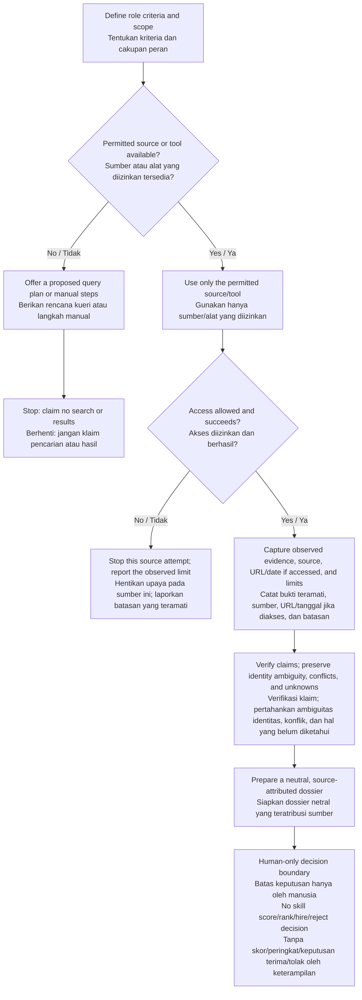

```text
+----------------------------------+
|          TALENT NEXUS            |
|   EVIDENCE > ASSUMPTIONS         |
|      BUKTI > ASUMSI              |
+----------------------------------+
```

# TALENT NEXUS

**EN:** Ethical talent research, grounded in professional evidence.  
**ID:** Riset talenta yang etis, berlandaskan bukti profesional.

**EN:** TALENT NEXUS is a platform-neutral agent skill for human-led discovery and neutral organization of public professional evidence. Its instructions guide role-focused query planning, source-aware discovery and verification, evidence dossiers, and optional professional-channel outreach. It is an instruction package—not a search platform, application, or hiring system.  
**ID:** TALENT NEXUS adalah keterampilan agen yang netral terhadap platform untuk penemuan dan penataan netral bukti profesional publik yang dipimpin manusia. Instruksinya memandu perencanaan kueri yang berfokus pada peran, penemuan dan verifikasi yang memperhatikan sumber, dossier bukti, serta pilihan pesan melalui kanal profesional. Ini adalah paket instruksi—bukan platform pencarian, aplikasi, ataupun sistem perekrutan.

**EN:** Human reviewers retain every assessment decision. TALENT NEXUS must not score, rank, or shortlist candidates, predict job performance, or recommend or automate whom to hire or reject.  
**ID:** Peninjau manusia tetap memegang seluruh keputusan penilaian. TALENT NEXUS tidak boleh memberi skor, mengurutkan, atau membuat daftar pendek kandidat, memprediksi kinerja kerja, ataupun merekomendasikan atau mengotomatiskan siapa yang diterima atau ditolak.

## Table of contents / Daftar isi

- [Overview / Ikhtisar](#overview)
- [Package contents / Isi paket](#package-contents)
- [Reference library / Pustaka referensi](#reference-library)
- [Documented workflow / Alur kerja yang didokumentasikan](#documented-workflow)
- [Desk-check scenarios / Skenario pemeriksaan manual](#desk-check-scenarios)
- [Safety and privacy / Keselamatan dan privasi](#safety-and-privacy)
- [Limitations / Batasan](#limitations)
- [Installation and use / Instalasi dan penggunaan](#installation-and-use)

<a id="overview"></a>
## Overview / Ikhtisar

**EN:** The core instructions are in [`talent-nexus/SKILL.md`](talent-nexus/SKILL.md). They direct an agent to keep professional-source discovery, evidence verification, and human assessment separate; attribute claims; make uncertainty visible; and provide a query plan or manual workflow when no suitable permitted search tool is available.  
**ID:** Instruksi inti terdapat di [`talent-nexus/SKILL.md`](talent-nexus/SKILL.md). Instruksi tersebut mengarahkan agen untuk memisahkan penemuan sumber profesional, verifikasi bukti, dan penilaian manusia; mengatribusikan klaim; memperjelas ketidakpastian; serta memberikan rencana kueri atau alur kerja manual bila tidak tersedia alat pencarian yang sesuai dan diizinkan.

**EN:** The skill itself supplies neither source access nor search results. It must not claim that a browser, website, platform, or other source was accessed unless an available permitted tool actually did so.  
**ID:** Keterampilan ini sendiri tidak menyediakan akses sumber maupun hasil pencarian. Keterampilan ini tidak boleh mengklaim bahwa peramban, situs web, platform, atau sumber lain telah diakses kecuali alat yang tersedia dan diizinkan benar-benar melakukannya.

<a id="package-contents"></a>
## Package contents / Isi paket

- **EN:** [`talent-nexus/SKILL.md`](talent-nexus/SKILL.md) contains the agent-skill instructions, safety boundaries, workflow, required dossier fields, common failure modes, and final review checklist. It also links to the reference guides and scenario document.  
  **ID:** [`talent-nexus/SKILL.md`](talent-nexus/SKILL.md) berisi instruksi keterampilan agen, batas keselamatan, alur kerja, kolom dossier yang diwajibkan, pola kegagalan umum, dan daftar periksa akhir. Berkas ini juga menautkan panduan referensi dan dokumen skenario.
- **EN:** `talent-nexus/references/` contains eight focused Markdown guides linked from `SKILL.md`. Direct links are listed below.  
  **ID:** `talent-nexus/references/` berisi delapan panduan Markdown khusus yang ditautkan dari `SKILL.md`. Tautan langsung tersedia di bawah.
- **EN:** [`talent-nexus/tests/validation-scenarios.md`](talent-nexus/tests/validation-scenarios.md) documents 15 manual/desk-check scenarios. They are not automated runtime tests.  
  **ID:** [`talent-nexus/tests/validation-scenarios.md`](talent-nexus/tests/validation-scenarios.md) mendokumentasikan 15 skenario pemeriksaan manual/desk-check. Skenario tersebut bukan pengujian runtime otomatis.

<a id="reference-library"></a>
## Reference library / Pustaka referensi

**EN:** The skill file is the package’s reference map; it links to all eight guides below.  
**ID:** Berkas keterampilan merupakan peta referensi paket; berkas tersebut menautkan kedelapan panduan di bawah ini.

- [Ethical OSINT and privacy / OSINT etis dan privasi](talent-nexus/references/ethical-osint-privacy.md) — **EN:** Purpose limitation, minimization, retention, access control, transparency, and privacy boundaries. **ID:** Pembatasan tujuan, minimalisasi, retensi, kontrol akses, transparansi, dan batas privasi.
- [Source directory and access limits / Direktori sumber dan batas akses](talent-nexus/references/source-directory-access-limits.md) — **EN:** Illustrative professional-source categories and a protocol for distinguishing permitted access from assumed access. **ID:** Kategori sumber profesional sebagai ilustrasi dan protokol untuk membedakan akses yang diizinkan dari akses yang diasumsikan.
- [Recruiter workflow and modes / Alur kerja dan mode perekrut](talent-nexus/references/recruiter-workflow-modes.md) — **EN:** Query planning, discovery, verification, dossier organization, structured follow-up, and optional professional outreach. **ID:** Perencanaan kueri, penemuan, verifikasi, penataan dossier, tindak lanjut terstruktur, dan pilihan pesan profesional.
- [Boolean and keyword search playbook / Panduan pencarian Boolean dan kata kunci](talent-nexus/references/boolean-keyword-search.md) — **EN:** Illustrative query-building patterns; examples are not claims that a search ran or returned results. **ID:** Pola penyusunan kueri sebagai ilustrasi; contoh bukan klaim bahwa pencarian telah dijalankan atau menghasilkan temuan.
- [Research modules / Modul riset](talent-nexus/references/research-modules.md) — **EN:** Guidance for professional branding, skill verification, career trajectory, descriptive matching, bounded talent mapping, reporting, and tool/error handling. **ID:** Panduan untuk pencitraan profesional, verifikasi keterampilan, perjalanan karier, pencocokan deskriptif, pemetaan talenta terbatas, pelaporan, serta penanganan alat/kesalahan.
- [Evidence verification / Verifikasi bukti](talent-nexus/references/evidence-verification.md) — **EN:** Evidence states, provenance, identity ambiguity, recency, conflicts, and limitations. **ID:** Status bukti, asal-usul, ambiguitas identitas, kebaruan, konflik, dan keterbatasan.
- [Neutral talent dossier template / Templat dossier talenta netral](talent-nexus/references/talent-dossier-template.md) — **EN:** A source-attributed record structure for claims, verification, unknowns, and human follow-up. **ID:** Struktur catatan teratribusi sumber untuk klaim, verifikasi, hal yang belum diketahui, dan tindak lanjut manusia.
- [Professional outreach templates / Templat pesan profesional](talent-nexus/references/outreach-templates.md) — **EN:** Optional, low-pressure professional-channel wording with instructions to stop after a decline. **ID:** Contoh pesan opsional dan tanpa tekanan melalui kanal profesional, dengan instruksi untuk berhenti setelah penolakan.

<a id="documented-workflow"></a>
## Documented workflow / Alur kerja yang didokumentasikan

**EN:** The diagram summarizes the human-led process described in `SKILL.md`; it is guidance, not an included search or data-processing runtime.  
**ID:** Diagram ini merangkum proses yang dipimpin manusia sebagaimana dijelaskan dalam `SKILL.md`; ini adalah panduan, bukan runtime pencarian atau pemrosesan data yang disertakan.



### Example request briefs / Contoh arahan riset

**EN:** These examples guide a host agent; they do not initiate searches or imply source access. Use only sources or tools actually supplied and permitted.  
**ID:** Contoh ini memandu agen host; contoh ini tidak memulai pencarian atau menyiratkan akses sumber. Gunakan hanya sumber atau alat yang benar-benar disediakan dan diizinkan.

> **EN:** Help plan sourcing for **[role]** using **[job-related criteria]**. Suggest relevant source categories and draft queries, label each query as proposed, and state what source/tool access is actually available. Do not invent people, counts, or results, and do not score or rank anyone.  
> **ID:** Bantu merencanakan pencarian talenta untuk **[peran]** berdasarkan **[kriteria terkait pekerjaan]**. Sarankan kategori sumber yang relevan dan susun draf kueri, tandai setiap kueri sebagai usulan, serta jelaskan akses sumber/alat yang benar-benar tersedia. Jangan mengarang orang, jumlah, atau hasil, dan jangan memberi skor atau peringkat kepada siapa pun.

> **EN:** Using only the professional source materials I provide, organize evidence for **[role-related criterion]**. For each claim, record its source, relevant passage, date if known, evidence/verification status, ambiguity, conflicts, and limitations. Keep missing information unknown; make no shortlist or hiring recommendation.  
> **ID:** Dengan hanya menggunakan materi sumber profesional yang saya berikan, tata bukti untuk **[kriteria terkait peran]**. Untuk setiap klaim, catat sumber, bagian yang relevan, tanggal bila diketahui, status bukti/verifikasi, ambiguitas, konflik, dan keterbatasan. Biarkan informasi yang tidak tersedia tetap berstatus belum diketahui; jangan membuat daftar pendek atau rekomendasi perekrutan.

<a id="desk-check-scenarios"></a>
## Desk-check scenarios / Skenario pemeriksaan manual

**EN:** The [scenario document](talent-nexus/tests/validation-scenarios.md) contains 15 hypothetical manual/desk-check cases using synthetic prompts. Topics include query planning, source/tool limits, professional evidence, claim verification, ambiguous identity, conflicting sources, discriminatory requests, and unauthorized personal-data requests.  
**ID:** [Dokumen skenario](talent-nexus/tests/validation-scenarios.md) memuat 15 kasus hipotetis pemeriksaan manual/desk-check dengan prompt sintetis. Topiknya mencakup perencanaan kueri, batas sumber/alat, bukti profesional, verifikasi klaim, identitas ambigu, sumber yang bertentangan, permintaan diskriminatif, dan permintaan data pribadi tanpa izin.

**EN:** The document states that no external candidate search was performed; platform access and search behavior remain untested, and query-planning behavior was desk-checked only. “Demonstrated” refers to documented safe responses, not host-tool execution.  
**ID:** Dokumen tersebut menyatakan bahwa tidak ada pencarian kandidat eksternal yang dilakukan; akses platform dan perilaku pencarian belum diuji, sedangkan perencanaan kueri hanya diperiksa secara desk-check. Istilah “ditunjukkan” merujuk pada respons aman yang didokumentasikan, bukan eksekusi alat host.

<a id="safety-and-privacy"></a>
## Safety and privacy / Keselamatan dan privasi

- **EN:** Use only publicly accessible professional evidence through methods allowed by the source, applicable law, and the host environment. Public availability does not prove accuracy, identity, consent to contact, or permission to automate or reuse content.  
  **ID:** Gunakan hanya bukti profesional yang dapat diakses publik melalui metode yang diizinkan oleh sumber, hukum yang berlaku, dan lingkungan host. Ketersediaan publik tidak membuktikan keakuratan, identitas, persetujuan untuk dihubungi, ataupun izin untuk mengotomatiskan atau menggunakan kembali konten.
- **EN:** Never bypass access controls or use credentials, private accounts, leaked data, phishing, unauthorized scraping, mass collection, or personal-channel outreach. Do not seek private addresses, personal phone numbers, or other sensitive personal data.  
  **ID:** Jangan pernah melewati kontrol akses atau menggunakan kredensial, akun privat, data bocor, phishing, pengambilan data tanpa izin, pengumpulan massal, ataupun pesan melalui kanal pribadi. Jangan mencari alamat rumah, nomor telepon pribadi, atau data pribadi sensitif lainnya.
- **EN:** Do not infer or use protected or sensitive traits, proxies, personality, mental health, character, or job performance from social activity, photos, likes, or follower counts. Decline discriminatory requests and, where possible, offer a role-relevant alternative.  
  **ID:** Jangan menyimpulkan atau menggunakan karakteristik yang dilindungi atau sensitif, proksi, kepribadian, kesehatan mental, karakter, ataupun kinerja kerja dari aktivitas sosial, foto, tanda suka, atau jumlah pengikut. Tolak permintaan diskriminatif dan, bila memungkinkan, tawarkan alternatif yang relevan dengan peran.
- **EN:** Minimize collection, keep the purpose narrow, and preserve source attribution, context, uncertainty, and retention considerations for human review.  
  **ID:** Minimalkan pengumpulan, batasi tujuan, dan pertahankan atribusi sumber, konteks, ketidakpastian, serta pertimbangan retensi untuk peninjauan manusia.

**EN:** Publicly accessible data is not automatically free to collect, use, or retain. Check the privacy and data-protection laws applicable to the relevant jurisdictions, source-platform terms, and organizational policies. This guidance is not legal advice.  
**ID:** Data yang dapat diakses publik tidak otomatis bebas untuk dikumpulkan, digunakan, atau disimpan. Periksa hukum privasi dan perlindungan data yang berlaku di yurisdiksi terkait, ketentuan platform sumber, dan kebijakan organisasi. Panduan ini bukan nasihat hukum.

<a id="limitations"></a>
## Limitations / Batasan

- **EN:** `talent-nexus/` contains Markdown instructions and reference material, not an application runtime. No installer, connectors, search service, or live-data integration is included.  
  **ID:** `talent-nexus/` berisi instruksi dan materi referensi Markdown, bukan runtime aplikasi. Tidak ada penginstal, konektor, layanan pencarian, ataupun integrasi data langsung yang disertakan.
- **EN:** Actual source access depends on the host agent’s available tools, source rules, permissions, and human-provided material. The skill must report observed access accurately; otherwise it can provide query planning and manual steps only.  
  **ID:** Akses sumber yang sebenarnya bergantung pada alat yang tersedia bagi agen host, aturan sumber, izin, dan materi yang diberikan manusia. Keterampilan ini harus melaporkan akses yang benar-benar terjadi secara akurat; jika tidak, keterampilan ini hanya dapat memberikan perencanaan kueri dan langkah manual.
- **EN:** The 15 scenarios are documented desk-checks, not automated tests or evidence of live search behavior. The scenario file explicitly leaves host search/browser access and search behavior untested.  
  **ID:** Kelima belas skenario tersebut adalah desk-check yang didokumentasikan, bukan pengujian otomatis atau bukti perilaku pencarian langsung. Berkas skenario secara eksplisit menyatakan bahwa akses pencarian/peramban host dan perilaku pencarian belum diuji.
- **EN:** Public material can be incomplete, stale, inaccurate, or identity-ambiguous. Verify claims against accessible original sources; do not treat absent evidence as a negative judgment or a source summary as a hiring conclusion.  
  **ID:** Materi publik dapat tidak lengkap, usang, tidak akurat, atau memiliki identitas ambigu. Verifikasi klaim melalui sumber asli yang dapat diakses; jangan perlakukan ketiadaan bukti sebagai penilaian negatif atau ringkasan sumber sebagai kesimpulan perekrutan.

<a id="installation-and-use"></a>
## Installation and use / Instalasi dan penggunaan

**EN — Platform-neutral setup:** Copy the entire [`talent-nexus/` directory](talent-nexus/) into the skill directory documented by the agent you choose. Keep `SKILL.md`, `references/`, and `tests/` together so the package’s relative links remain intact. Then follow that agent’s own documentation to discover, load, or invoke the skill.  
**ID — Penyiapan netral-platform:** Salin seluruh [direktori `talent-nexus/`](talent-nexus/) ke direktori keterampilan yang didokumentasikan oleh agen pilihan Anda. Pertahankan `SKILL.md`, `references/`, dan `tests/` bersama-sama agar tautan relatif paket tetap berfungsi. Setelah itu, ikuti dokumentasi agen tersebut untuk menemukan, memuat, atau memanggil keterampilan ini.

**EN:** This repository specifies no universal installation path, installer, command, or invocation syntax. The copy instruction is platform-neutral guidance, not a tested installer or a guarantee of compatibility with every agent host.  
**ID:** Repositori ini tidak menetapkan jalur instalasi, penginstal, perintah, ataupun sintaks pemanggilan universal. Petunjuk penyalinan ini adalah panduan netral-platform, bukan penginstal yang telah diuji atau jaminan kompatibilitas dengan setiap host agen.

**EN:** Once available to a host agent, use `SKILL.md` as its guidance and follow the host’s documented process. If no suitable permitted search tool or source is available, request a query plan or manual workflow; do not claim a search or access occurred.  
**ID:** Setelah tersedia bagi agen host, gunakan `SKILL.md` sebagai panduannya dan ikuti proses yang didokumentasikan oleh host. Jika tidak tersedia alat pencarian atau sumber yang sesuai dan diizinkan, mintalah rencana kueri atau alur kerja manual; jangan mengklaim bahwa pencarian atau akses telah terjadi.
